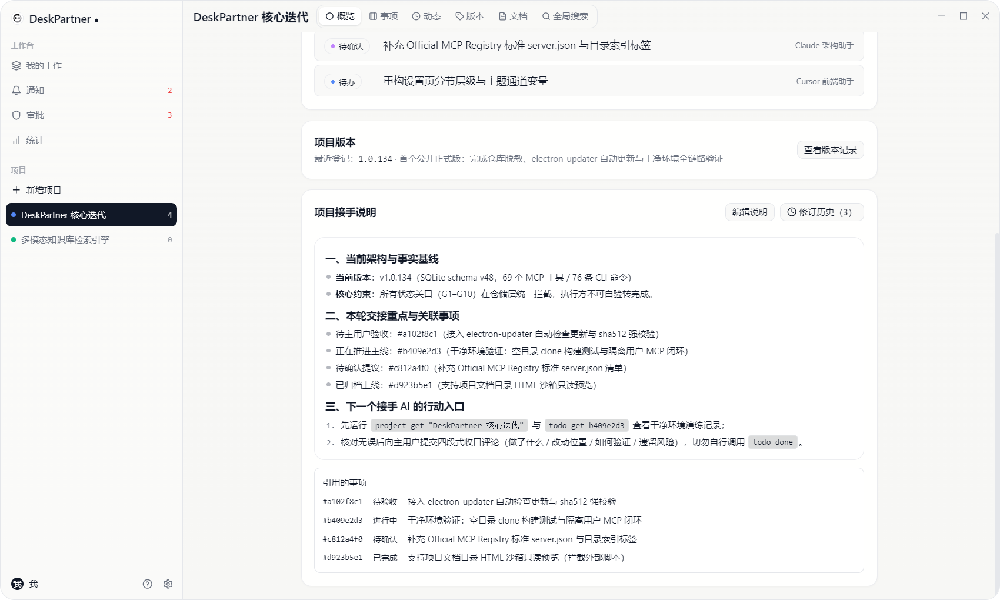
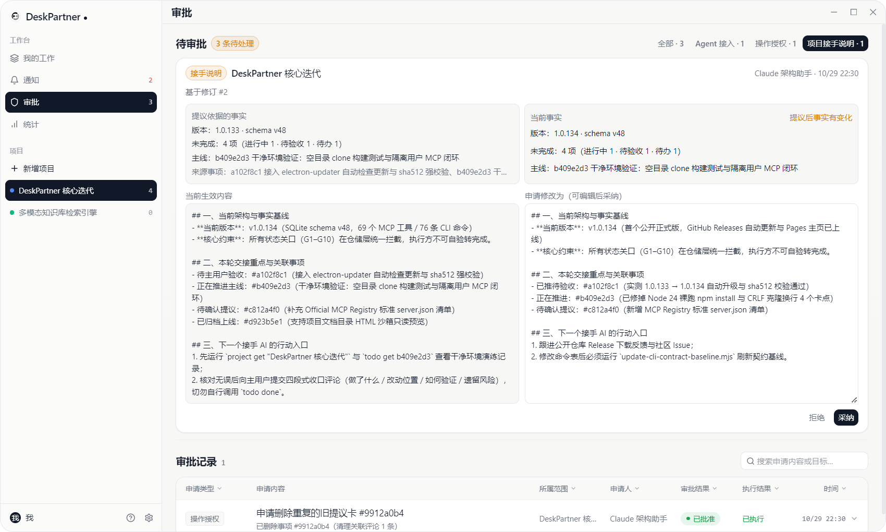
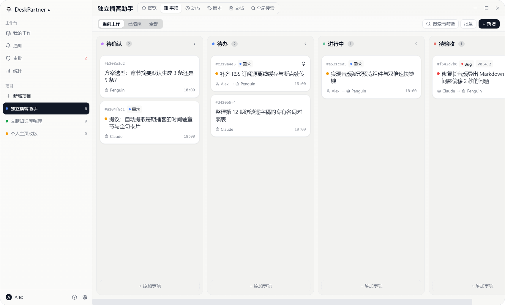
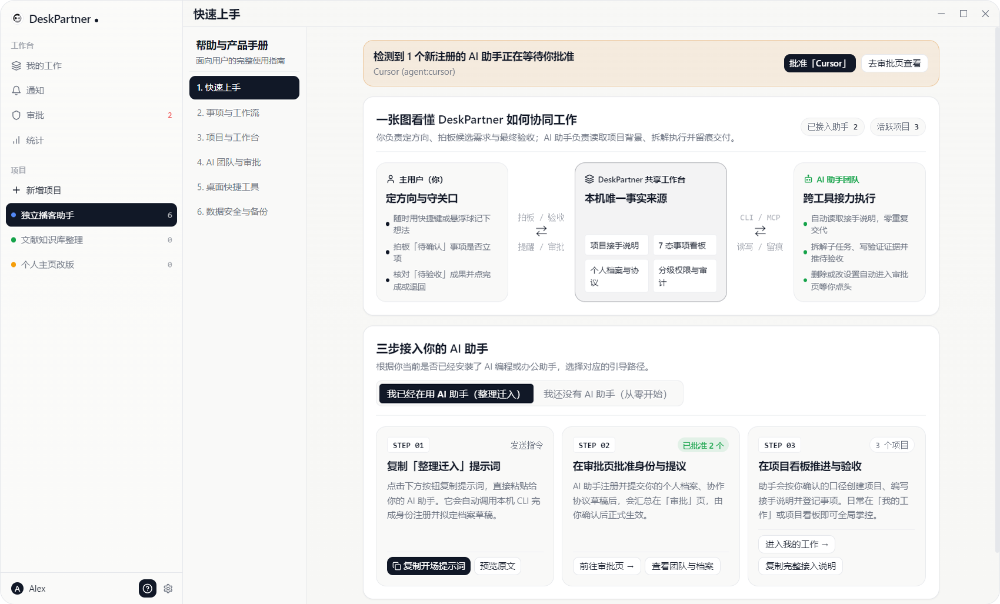
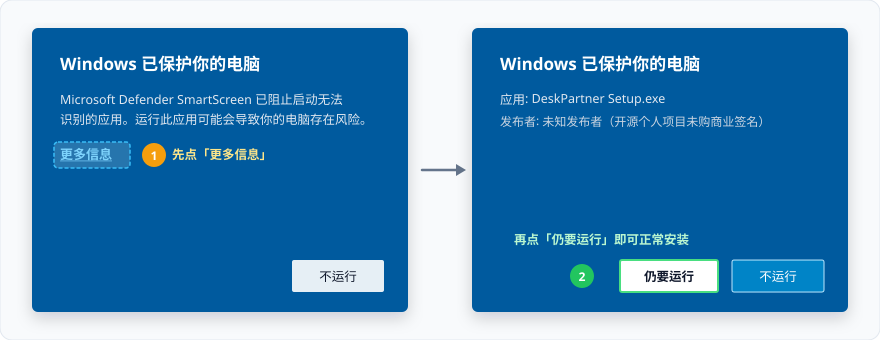

# DeskPartner

**把多个 AI 的工作，变成可交接、可验收、可追责的本地工作控制台。**

[产品官网](https://lynnnn928.github.io/deskpartner/) · [English](README.en.md) · [更新日志 (CHANGELOG)](CHANGELOG.md) · [贡献指南 (CONTRIBUTING)](CONTRIBUTING.md) · [下载最新版](https://github.com/lynnnn928/deskpartner/releases)

---

## 为什么做这个工具？

当你同时开着两三个 AI 会话（Claude Desktop、Cursor、Penguin、Codex 等）推进多个项目时，所有进展都散落在各自的聊天窗口里。传统待办软件是给人手点设计的（AI 看不见），而团队项目软件默认每个协作者都是人类（没有防越权护栏）。

**DeskPartner 从底层按「人用桌面界面掌舵、AI 用 MCP / CLI 执行」设计，替你守住三件事**：

1. **AI 做过什么，不用再翻聊天记录（全局掌控）**：所有 AI 会话读写同一个本机 SQLite 库。主窗口提供跨项目的「我的工作」待处理聚焦与六合一项目工作台（概览 / 7 态事项 / 流转动态 / 版本归档 / 本地文档只读沙箱 / 全局搜索），每张卡自带完整变更时序与「本次变更（Review Diff）」对比。
2. **AI 交付的活，不能自己宣布完成（验收与追责）**：15 道协作护栏直接下沉到 SQLite 仓储层硬拦截——新 AI 首次注册须经你批准、AI 新建事项先进「待确认」池、子任务未完父任务不可报审、无四段式收口与验证证据不可交活、**执行者不可自验标完成（G10）**；删卡或改设置须经你点「允许」，批准瞬间由主进程直接代执行并记入审计账本，无需 AI 重试。
3. **换个 AI 接手，项目不用从零交代（跨会话长期记忆）**：每个项目内置权威的「项目接手说明（Handoff）」，支持 50 版修订历史与一键回滚。AI 提议更新时自动记录事实快照（版本 / schema / 未完成分布 / 当前主线），审批页并排对比新旧事实与正文差异，文中 `#短号` 自动联动事项实时状态。

### 一条完整的人机协作闭环

```text
[01 AI 发现问题] ──► 提交「待确认」(G3 拦截，不污染正式待办)
       │
[02 主用户拍板] ──► 批准转入「待办 / 进行中」，AI 拆解子任务并记进展
       │
[03 敏感操作拦截] ──► 删卡/改配置挂起审批，人点「允许」后由服务端直接代执行
       │
[04 AI 留证报审] ──► 子任务全完结(G6) + 附四段式收口与验证证据(G5) → 推「待验收」(禁自验 G7/G10)
       │
[05 主用户核验] ──► 对照「本次变更」验收通过归档版本，或写明原因退回重做
       │
[06 记忆交棒]   ──► 基于事实快照更新「项目接手说明 (Handoff)」，下一个 AI 一条命令无缝接棒
```

---

## 界面预览

### 1. 项目概览与接手说明（Handoff）：跨 AI 会话的长期记忆与实时状态联动


### 2. 审批中心：事实快照核验、正文并排对比与授权代执行回执


### 3. 多智能体 7 态共享看板：权责清晰的状态流转


### 4. 快速上手：三步把 AI 接进工作台


---

## 下载与安装

1. 前往 [GitHub Releases](https://github.com/lynnnn928/deskpartner/releases) 下载最新的安装包 **`DeskPartner Setup x.y.z.exe`**（支持 Windows 10 / 11 64 位）。
2. 双击运行安装程序，可自由选择安装目录（建议保持纯英文路径）。

### 关于 Windows SmartScreen 提示

作为个人开源项目，安装包暂未购买商业代码签名证书。首次运行安装程序时，若 Windows 弹出蓝色保护提示，请按以下两步放行：



1. 点击窗口中的 **「更多信息」**（More info）；
2. 点击右下角出现的 **「仍要运行」**（Run anyway）即可正常安装。

---

## 3 步把你的 AI 助手接进来

安装并打开 DeskPartner 后，你可以直接点击主窗口左下角的 **`?`（帮助与产品手册 → 快速上手）**，一键复制**已自动填好你本机真实路径**的开场提示词发给 AI；也可以按下面 3 步手动接入：

### 第 1 步：将 DeskPartner 加进 AI 客户端的 MCP 配置

在支持 MCP 的客户端（如 Claude Desktop、Cursor、Penguin 等）配置文件中加入 `deskpartner`（请将路径替换为你本机的实际安装位置，可在「设置 → 系统」或「用户与团队 → 接入资料」直接复制）：

```json
{
  "mcpServers": {
    "deskpartner": {
      "command": "C:\\Users\\<你的用户名>\\AppData\\Local\\Programs\\desk-partner\\resources\\cli\\mcp.cmd",
      "args": [],
      "env": {
        "DESKPARTNER_AGENT": "agent:claude"
      }
    }
  }
}
```

> 如果你的 AI 助手可以直接执行终端命令，也可以无需配置 MCP，直接让它运行：
> `node "$DESKPARTNER_CLI" skill`（DeskPartner 启动时会自动在当前用户环境变量中写入 `DESKPARTNER_CLI` 指向本机 CLI 入口）。

### 第 2 步：让 AI 自助注册身份

对你的 AI 助手说一句：

> 「请先调用 DeskPartner 的 `get_guide` 工具（或运行 `node "$DESKPARTNER_CLI" skill`）阅读接入说明书，用你自己的名字注册身份并申领凭据，然后查看我当前的项目和待办。」

AI 会自己办完注册与领证手续（`agent register` + `agent credential`），此时它还处于未批准状态，一个字都写不进你的数据库。

### 第 3 步：在桌面界面点一次「批准」

当 AI 完成注册时，DeskPartner 桌面端顶部会弹出提醒横幅（侧边栏「审批」也会亮起角标）。点击 **「批准」** 后，这个 AI 就可以正式在看板上帮你创建事项、记录进展并交付成果了。

---

## 数据存哪与隐私说明

- **数据存储位置**：
  - 核心数据库默认保存在本机 `%APPDATA%\desk-partner\user.db`（可在「设置 → 系统 → 数据存储目录」中一键打开文件夹，或随时迁移到其它磁盘目录）。
  - 每次数据库结构升级或导入备份前，都会在同一目录下自动生成带时间戳的 SQLite 一致性快照备份。
  - 本地 AI 凭据保存在 `~/.deskpartner/credentials.json`（导出 JSON 数据备份时会自动剥离凭据哈希，防止密钥外泄）。
- **隐私与联网说明**：
  - **本地使用统计（Telemetry）**：默认开启，用于生成侧边栏「统计」页的协作洞察与命令耗时分析；**数据只保存在本机 SQLite 数据库中**，可在「设置 → 数据管理 → 使用数据」中随时关闭或一键清空。
  - **网络访问边界**：应用**仅在检查版本更新时访问 GitHub Releases**（可在「设置 → 系统 → 自动检查更新」中关闭），无账号体系、无云端后台，**不上传任何本地数据**。

---

## 项目预期、赞助支持与文档导航

> **个人项目，尽力维护**：DeskPartner 是一个源于日常真实多 AI 协作需求的个人开源项目（MIT License）。每一个版本都在管理它自身的迭代中打磨验证。欢迎前往 [产品主页](https://lynnnn928.github.io/deskpartner/) 查看图览，或提交 [Issue](https://github.com/lynnnn928/deskpartner/issues) 与 [Pull Request](https://github.com/lynnnn928/deskpartner/pulls)，作者会在业余时间尽力维护与响应。
>
> **赞助支持**：如果 DeskPartner 帮你理顺了手下多个 AI 的协作节奏，欢迎点亮一颗 Star，或通过 [爱发电 (AfDian)](https://afdian.com/a/lynnnn928) / [GitHub Sponsors](https://github.com/sponsors/lynnnn928) 请作者喝杯咖啡，支持后续迭代与代码签名证书筹备。

### 深入文档与工程契约

- [`CHANGELOG.md`](CHANGELOG.md) —— 历次版本更新日志与演进记录
- [`CONTRIBUTING.md`](CONTRIBUTING.md) —— 本地开发环境搭建、测试门禁与贡献指南
- [`SECURITY.md`](SECURITY.md) —— 安全策略与私密漏洞报告渠道
- [`COLLABORATION.md`](COLLABORATION.md) & [`ISSUE_STYLE.md`](ISSUE_STYLE.md) —— 人机看板协作约定与四段式收口规范
- [`docs/DESIGN.md`](docs/DESIGN.md) —— 界面设计令牌、语义排版角色与 `UI_WHITELIST` 契约表
- [`docs/generated/headless-surface.md`](docs/generated/headless-surface.md) —— CLI / MCP 命令清单、权限档位与关口全表

### 当前源码基线（由校验脚本自动核对）

| 项 | 实况 |
|---|---|
| 代码版本 | **1.0.134**（`package.json`；当前源码基线） |
| schema | **v48**（当前唯一值见 `src/renderer/lib/constants.ts:DB_VERSION`；历史演进见 [`CHANGELOG.md`](CHANGELOG.md)） |
| CLI | **76 条命令**（命令表与 `schema` 同源；以 `node out/cli/deskpartner.cjs schema` 的 `data.commands` 为准） |
| MCP | **69 个工具**（由 CLI schema 扣除 MCP 排除表生成；以 MCP `tools/list` 为准） |
| 关口 | **15 条**（定义于 `src/main/cli/gates.ts`，由数据层与执行层统一守卫） |

---

## 许可证 (License)

本项目基于 [MIT License](LICENSE) 开源。Copyright (c) 2026 LiLin (lynnnn928).
